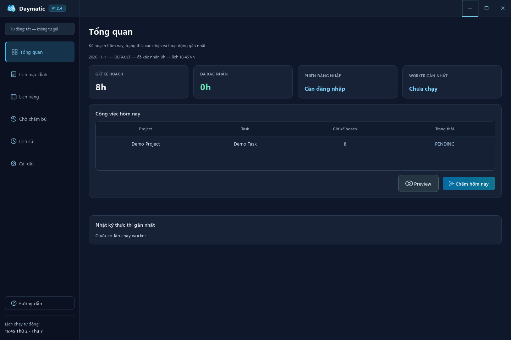
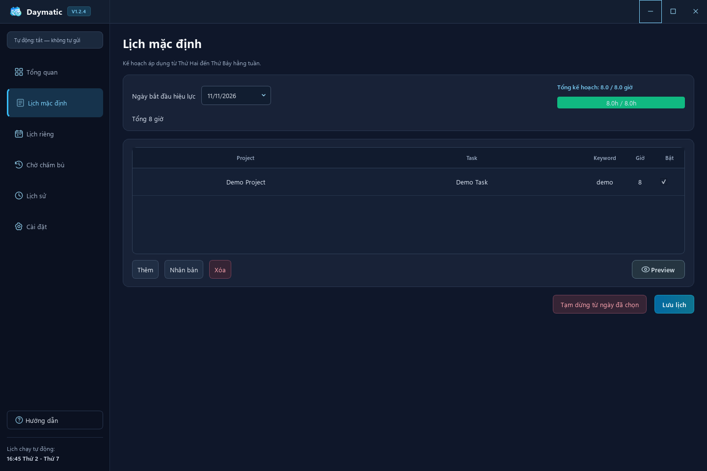
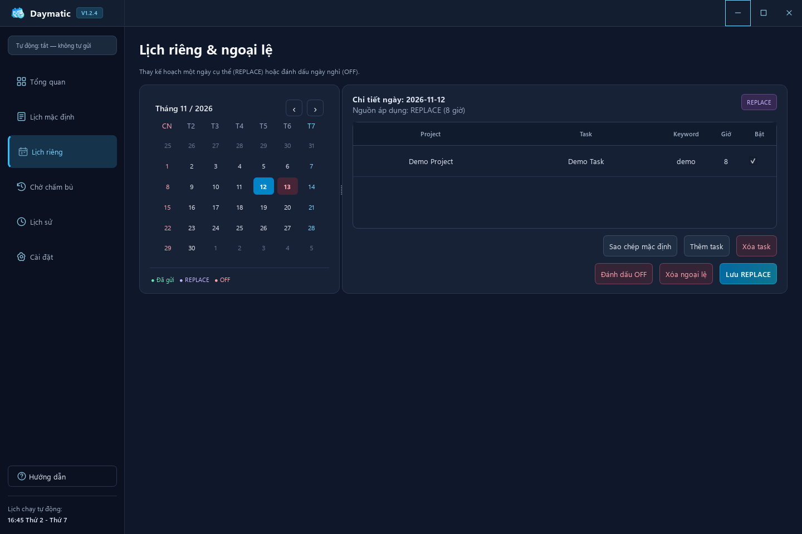

<h1 align="center">DayMatic</h1>

<p align="center">
  <strong>Lên lịch một lần, bớt việc ghi giờ công mỗi ngày.</strong><br>
  Trợ lý quản lý lịch làm việc và ghi giờ công trên Windows & Ubuntu.
</p>

<p align="center">
  <a href="https://github.com/TKNguyenn/daymatic-releases/releases/latest"><strong>Tải phiên bản mới nhất</strong></a>
  &nbsp;·&nbsp;
  <a href="#chức-năng-chính">Chức năng</a>
  &nbsp;·&nbsp;
  <a href="#bắt-đầu-sử-dụng">Bắt đầu sử dụng</a>
</p>



## DayMatic giúp gì cho bạn?

Nếu công việc mỗi ngày thường lặp lại cùng project, task và số giờ, DayMatic giúp bạn lưu sẵn kế hoạch và ghi giờ công theo lịch đã duyệt. Những ngày đổi việc, nghỉ phép hoặc cần chấm bù vẫn có chỗ quản lý riêng, dễ kiểm tra lại.

Bạn có thể xem kế hoạch hôm nay, kiểm tra đúng công việc bằng **Preview**, chủ động chấm trong app hoặc bật lịch tự động. Lịch sử ghi lại kết quả để bạn biết lần nào thành công, lần nào cần xử lý.

DayMatic làm việc với website chấm công đã được tích hợp trong ứng dụng. Bạn cần có tài khoản và quyền truy cập website đó để sử dụng.

## Chức năng chính

| Chức năng | Bạn có thể làm gì? |
| --- | --- |
| **Tổng quan hôm nay** | Xem công việc, giờ kế hoạch, trạng thái đăng nhập và hoạt động gần nhất trong một màn hình. |
| **Lịch mặc định** | Lưu project, task và số giờ cho lịch làm việc lặp lại từ Thứ Hai đến Thứ Bảy. |
| **Lịch riêng theo ngày** | Đổi toàn bộ kế hoạch của một ngày, đánh dấu ngày nghỉ hoặc tạo lịch làm việc Chủ nhật. |
| **Preview trước khi chấm** | Kiểm tra đúng project/task trên website trước khi gửi. Preview không nhập giờ và không gửi chấm công. |
| **Chấm hôm nay** | Chủ động ghi giờ công cho ngày hiện tại theo kế hoạch đã kiểm tra. |
| **Lịch chạy tự động** | Chọn giờ chạy theo múi giờ Việt Nam; ứng dụng thực hiện theo kế hoạch và quyền tự động bạn đã bật. |
| **Chờ chấm bù** | Rà soát những ngày còn thiếu trong phạm vi hỗ trợ và duyệt từng ngày trước khi chấm bù. |
| **Lịch sử & xuất CSV** | Tra cứu, lọc kết quả, xem trạng thái/lỗi và xuất danh sách đang lọc để đối chiếu. |
| **Tài khoản & phiên đăng nhập** | Tùy chọn lưu tài khoản trên máy và tự đăng nhập lại khi phiên hết hạn. |

## Giao diện ứng dụng

Các ảnh được chụp từ giao diện Windows của Daymatic 1.2.4 với **dữ liệu hoàn toàn giả lập**: project `Demo Project`, task `Demo Task` và keyword `demo`.

### Lên kế hoạch làm việc

Chọn ngày hiệu lực, thêm project/task và phân bổ số giờ. Lịch đã lưu được dùng cho những ngày làm việc tiếp theo.



### Linh hoạt cho từng ngày

Theo dõi lịch trên một màn hình, thay kế hoạch cho ngày đặc biệt hoặc đánh dấu **OFF** cho ngày nghỉ.



## Tải và cài đặt

**Phiên bản hiện tại: [DayMatic 1.2.5](https://github.com/TKNguyenn/daymatic-releases/releases/tag/v1.2.5).** Bộ cài đã kèm Python và Chromium.

| Hệ điều hành | Bộ cài | Cách cài |
| --- | --- | --- |
| **Windows x64** | [Tải bộ cài Windows (.exe)](https://github.com/TKNguyenn/daymatic-releases/releases/download/v1.2.5/Daymatic-Setup-1.2.5.exe) | Mở file và làm theo trình cài đặt. |
| **Ubuntu Desktop 24.04 x64 / amd64** | [Tải bộ cài Ubuntu (.deb)](https://github.com/TKNguyenn/daymatic-releases/releases/download/v1.2.5/Daymatic-1.2.5-ubuntu-24.04-amd64.deb) | Mở bằng **App Center** → **Install**, rồi mở **Daymatic** từ menu ứng dụng. |

Ubuntu cần mạng để tải các thư viện hệ thống còn thiếu và mật khẩu quản trị của máy để cài gói. Bản Ubuntu hiện hỗ trợ **24.04 Desktop x64**, chưa hỗ trợ ARM hoặc các phiên bản Ubuntu cũ hơn.

<details>
<summary>Nếu file Ubuntu không mở bằng App Center</summary>

Trong thư mục chứa file tải về, chạy:

```bash
sudo apt install ./Daymatic-1.2.5-ubuntu-24.04-amd64.deb
```

Sau khi cài, mở app từ menu bằng tài khoản người dùng bình thường; không chạy app bằng `sudo`.

</details>

## Bắt đầu sử dụng

1. **Kết nối tài khoản:** mở Cài đặt và đăng nhập vào website chấm công. Nếu muốn tự đăng nhập lại khi phiên hết hạn, dùng tùy chọn lưu tài khoản trong app.
2. **Tạo lịch làm việc:** thêm đúng tên project/task, từ khóa tìm kiếm và số giờ vào Lịch mặc định. Dùng Lịch riêng cho ngày đổi việc hoặc nghỉ.
3. **Chạy Preview:** kiểm tra đúng công việc trên website. Khi có nhiều task, chọn task cần kiểm tra.
4. **Chọn cách chấm:** dùng Chấm hôm nay khi cần chủ động, hoặc cài lịch và bật tự động trong Cài đặt sau khi Preview hợp lệ.
5. **Theo dõi kết quả:** xem Lịch sử và rà soát Chờ chấm bù khi có ngày chưa được ghi nhận.

Trong ứng dụng có **Hướng dẫn** kèm ảnh minh họa để bạn xem lại từng bước.

## Bạn luôn kiểm soát việc gửi giờ công

- **Tự động mặc định tắt.** Đăng nhập hay chạy Preview không tự bật quyền gửi giờ công.
- **Kiểm tra trước khi gửi.** Thay đổi tài khoản hoặc cấu hình công việc cần được Preview lại trước khi bật tự động.
- **Có cơ chế hạn chế gửi trùng.** Khi chưa xác định được kết quả một lần gửi, app giữ trạng thái cần kiểm tra thay vì tự gửi lại. Bạn nên đối chiếu website trước khi cho phép thử lại.
- **Tài khoản được lưu trên máy.** Windows dùng Credential Manager; Ubuntu dùng keyring của desktop. Phiên đăng nhập được mã hóa.

Để lịch tự động hoạt động, máy cần bật và đăng nhập phiên desktop; Ubuntu cần keyring đã mở khóa. Không bật tự động đồng thời trên hai máy hoặc hai hệ điều hành cho cùng một tài khoản, vì lịch sử của mỗi bản cài được lưu riêng.

## Cập nhật phiên bản

Nếu đang dùng **1.2.4**, hãy đóng Daymatic và cài **1.2.5** thủ công một lần. Trên Windows, chọn lại thư mục cài hiện tại để giữ dữ liệu. [Danh sách bộ cài](https://github.com/TKNguyenn/daymatic-releases/releases)

Từ **1.2.5**, bấm **Check for updates** dưới **Hướng dẫn** để kiểm tra ngay. Khi app đang chạy, Daymatic cũng kiểm tra sau 00:00 giờ Việt Nam mỗi ngày. Nếu có bản mới đúng hệ điều hành, app hỏi trước khi tải và cài. Ubuntu có thể yêu cầu mật khẩu quản trị.

Trước khi gỡ bản Ubuntu, tắt tự động và gỡ lịch Ubuntu trong Cài đặt. Gỡ gói vẫn giữ dữ liệu cá nhân và keyring.

Repo này chứa phần giới thiệu, ảnh và các bản phát hành. Hai mục **Source code** do GitHub tự tạo chứa tài liệu và ảnh của repo. Để cài ứng dụng, chọn file `.exe` hoặc `.deb` trong **Assets**.
